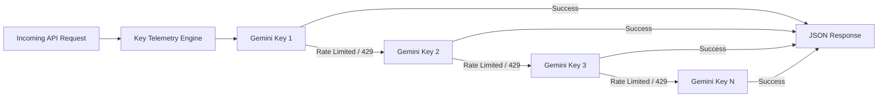

# ⚙️ Career Navigation AI — Backend API Engine

[](https://career-navigation-ai.ai.studio/api/health)
[](https://nodejs.org/)
[](https://expressjs.com/)
[](https://www.mongodb.com/atlas)
[](https://ai.google.dev/)
[](LICENSE)

High-performance Express.js REST API powering the **Career Navigation AI** platform. Built for enterprise scale with resilient multi-key Google Gemini API rotation, MongoDB Atlas persistence, Dual-Engine ATS scoring algorithms, real-time telemetry, and zero-retention guest audit endpoints.

---

## ⚡ Core Capabilities

- **Multi-Key Gemini API Pool:** Automatically rotates across up to 5 Gemini API keys with per-key latency, request counters, and automatic failover on quota limits (HTTP 429).
- **Dual-Engine ATS Scoring:** Computes an objective Universal Baseline ATS score (independent of role bias) alongside role-specific market compatibility.
- **Zero-Pollution Guest Scanner:** Dedicated endpoint `POST /api/resume/guest-scan` returning instant document health, telemetry, and 4 best-fit career roles without writing to MongoDB.
- **Single-Flight Career Orchestration:** `POST /api/career/analyze` executes multi-stage career mapping (parsing, ATS audit, roadmap, market intelligence) in one unified request.
- **STAR Interview Evaluation Engine:** AI evaluates behavioral and technical answers using Situation, Task, Action, and Result scoring with Hindi-to-English translation.
- **Hybrid Storage Architecture:** Primary storage on MongoDB Atlas with automatic, graceful fallback to localized memory database if Atlas is temporarily unreachable.

---

## 🔌 API Endpoints Reference

### 1. System & Telemetry
| Method | Endpoint | Description |
| :--- | :--- | :--- |
| `GET` | `/api/health` | Service health status and MongoDB connection verification |
| `GET` | `/api/system/keys-status` | Live Gemini API key pool health, latency, and success rates |

### 2. Authentication & User Profile
| Method | Endpoint | Auth | Description |
| :--- | :--- | :--- | :--- |
| `POST` | `/api/auth/register` | Public | Register new user account with salted password hashing |
| `POST` | `/api/auth/login` | Public | Authenticate user credentials and return JWT bearer token |
| `GET` | `/api/auth/me` | JWT | Retrieve current authenticated user profile and XP |
| `POST` | `/api/auth/reset-password` | Public | Reset password with verification |

### 3. Resume & ATS Scoring
| Method | Endpoint | Auth | Description |
| :--- | :--- | :--- | :--- |
| `POST` | `/api/resume/guest-scan` | Public | Instant 2s guest scan (Zero MongoDB persistence) |
| `POST` | `/api/resume/parse` | Optional | Extract skills, experience, projects, education from raw text |
| `POST` | `/api/resume/ats` | Optional | Compute Dual-Engine 8-factor ATS score & XYZ bullet rewrites |
| `POST` | `/api/resume/roadmap` | JWT | Generate personalized sprint-based career learning roadmap |
| `POST` | `/api/career/analyze` | Optional | Comprehensive end-to-end career mapping orchestration |

### 4. Market & Interview Coaching
| Method | Endpoint | Auth | Description |
| :--- | :--- | :--- | :--- |
| `POST` | `/api/salary/insights` | Public | Verified compensation benchmarks by role and city |
| `POST` | `/api/market/compare` | Public | Regional market demand vs candidate profile comparison |
| `POST` | `/api/interview/questions` | Public | Tailored STAR behavioral & technical interview questions |
| `POST` | `/api/interview/evaluate` | Public | Grade candidate answers against the STAR rubric |
| `POST` | `/api/interview/translate-answer`| Public | Voice answer audio/text translation from Hindi to English |

---

## 🛠️ Environment Variables

Create a `.env` file in the root directory:

```env
# Server Port
PORT=3000
NODE_ENV=production

# MongoDB Atlas Connection URI
MONGODB_URI=mongodb+srv://<username>:<password>@cluster0.mongodb.net/careernav?retryWrites=true&w=majority

# JWT Authentication Secret
JWT_SECRET=your_super_secret_jwt_key_here

# Rotating Google Gemini API Keys (Up to 5 keys for 100% uptime)
GEMINI_API_KEY=AIzaSy...
GEMINI_API_KEY_2=AIzaSy...
GEMINI_API_KEY_3=AIzaSy...
GEMINI_API_KEY_4=AIzaSy...
GEMINI_API_KEY_5=AIzaSy...

# Optional Admin Credentials
ADMIN_EMAIL=admin@careernav.ai
ADMIN_SECRET_KEY=secure_admin_key
```

---

## 🚀 Local Development

### Prerequisites
- Node.js v18.0.0+
- npm v9.0.0+

### Installation & Run
```bash
# 1. Clone the repository
git clone https://github.com/raj40870-pixel/ai-skill-backed.git
cd ai-skill-backed

# 2. Install dependencies
npm install

# 3. Compile backend bundle with esbuild
npx esbuild server.ts --bundle --platform=node --format=cjs --packages=external --sourcemap --outfile=dist/server.cjs

# 4. Start production server
node dist/server.cjs
```

Server starts at `http://localhost:3000`. Test health with:
```bash
curl http://localhost:3000/api/health
```

---

## 🌐 Production Deployment (Google AI Studio / Container)

1. **Build Container / Artifact:**
   Run `npm run build` or `npx esbuild server.ts --bundle --platform=node --format=cjs --packages=external --outfile=dist/server.cjs`.
2. **Start Command:**
   ```bash
   node dist/server.cjs
   ```
3. **Environment Setup:** Ensure all 5 Gemini keys and `MONGODB_URI` are added to the container environment.
4. **CORS & Reverse Proxy:** The backend automatically allows requests from `https://carrer-nav-ai.vercel.app` and localhost.

---

## 🛡️ Key Rotation & Telemetry Engine



The system continuously tracks:
- Total Requests & Success Rate (%)
- Latency (milliseconds) per key
- Rate-limit occurrences and automatic cooldown resets
- Zero downtime during high-traffic spikes

---

## 📄 License

This project is licensed under the [MIT License](LICENSE).
